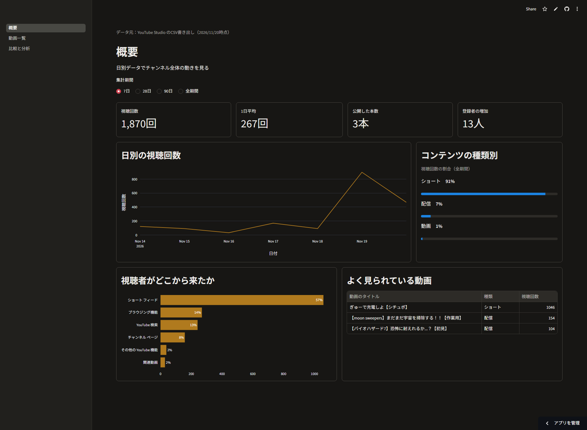

# おもち アナリティクス

自分のYouTubeチャンネル「きなこもち」のデータを分析するWebアプリです。
YouTube Studio の標準画面では答えにくい「何が視聴回数や登録者につながっているのか」を調べるために作りました。

- アプリ：[公開URLをここに貼る]
- 使用技術：Python / pandas / NumPy / Streamlit / Plotly



## 作った目的

チャンネルを運営する中で、次の疑問をデータで確かめたいと考えました。

- 夏以降に視聴回数が減ったのはなぜか
- ショート・通常の動画・配信は、それぞれどんな役割を持っているか
- 視聴回数が増えると、登録者はどのくらい増えるのか

## 画面と機能

| ページ | できること |
|---|---|
| 概要 | 期間（7日・28日・90日・全期間）を切り替えて、視聴回数・登録者の増加・公開本数・流入元・よく見られている動画を確認 |
| 動画一覧 | 全動画を種類（ショート・動画・配信）やタイトルで絞り込み、視聴回数や平均視聴時間で並べ替え |
| 比較と分析 | 種類別の比較、流入元の割合の月別推移、動画を公開した日としなかった日の比較、回帰分析 |

## データ

YouTube Studio のアナリティクスから、全期間のデータをCSVで書き出して使っています。

| ファイル | 内容 |
|---|---|
| 日別の視聴回数 | 日付ごとの視聴回数 |
| 日別の登録者数 | 日付ごとの登録者の増減 |
| 動画別データ | 動画ごとの視聴回数・総再生時間・登録者増・クリック率など |
| 流入元の日別データ | 日付×流入元（ショートフィード、検索など）ごとの視聴回数 |

推定収益などの非公開情報は、公開前にデータから削除しています。

## 工夫したこと

### データの下処理

書き出したCSVはそのままでは分析に使えないため、`src/load_data.py` で次の処理をしています。

- 1行目の「合計」行の除外、動画IDの前後の空白の削除
- 「Nov 5, 2026」形式の英語の日付を日付型に変換
- 動画の長さとタイトルから、種類（ショート・動画・配信・告知・非公開）を判定
- 告知用の投稿や非公開・メンバー限定の動画を分析から除外
- 日別の視聴回数と登録者数を、日付をキーに結合

### データの整合性の確認

- ファイルごとに最終日がずれていると、期間を絞ったときに数字が合わなくなることに気づき、すべて同じ日に書き出し直して最終日をそろえました
- 日別データの合計と動画別データの合計、流入元ごとの合計が一致することを確かめてから使っています

### 結果の見せ方

- 期間で絞り込めない数字（動画別の累計など）には「全期間」と明記し、期間を切り替えても変わらない理由がわかるようにしました
- 件数が少ない比較には「参考値」と注意書きを入れています

## わかったこと

- **視聴回数の約9割がショートから**来ている一方で、総再生時間では配信の比重が大きく、種類ごとに役割が違う
- **夏以降、ショートフィードからの流入の割合が大きく下がり**、視聴回数の減少の大部分を説明している。代わりにブラウジング機能（ホーム画面のおすすめ）とYouTube検索の割合が伸びた
- 日別データの回帰分析では、**1日の視聴回数が1,000回増えると登録者は約4.6人増える**傾向があり、決定係数は0.58だった
- 動画を公開した日は、公開しなかった日より視聴回数が大きく多い。ただし活動初期はほぼ毎日公開していて視聴回数も多い時期だったため、**時期の影響が混ざっている**点に注意が必要

## 今後やりたいこと

- YouTube Data API でコメントの時刻を取得し、視聴者が反応しやすい時間帯を分析する
- 投稿時間を変える実験の記録と比較
- AWS（S3・Lambda）でデータの取得を自動化する

## データの更新手順

新しいデータに入れ替えるときは、次の手順で行います。

### 1. YouTube Studio から書き出す

4つとも**同じ日に**、期間は**「全期間」**で書き出します。日がずれると最終日がそろわず、期間で絞ったときに数字が合わなくなります。

| タブ | グラフの指標 | 使うファイル | リネーム後 |
|---|---|---|---|
| 日付 | 視聴回数 | 合計.csv | `daily_views_all_YYYYMMDD.csv` |
| 日付 | チャンネル登録者 | 合計.csv | `daily_subscribers_all_YYYYMMDD.csv` |
| コンテンツ | どれでもよい | 表データ.csv | `videos_all_YYYYMMDD.csv` |
| トラフィックソース | 視聴回数（流入元を表示した状態） | グラフデータ.csv | `traffic_daily_all_YYYYMMDD.csv` |

- `YYYYMMDD` は書き出した日（例：`20261122`）
- 「合計.csv」の中身はグラフに表示している指標になるため、2つ目はグラフの指標を「チャンネル登録者」に切り替えてから書き出す
- 「グラフデータ.csv」は、グラフに流入元が表示された状態で書き出さないと空になる

### 2. 非公開情報を削除する

動画別データには推定収益の列が含まれるため、**リポジトリに入れる前に必ず削除**します。

```python
import pandas as pd

path = "data/raw/videos_all_YYYYMMDD.csv"
df = pd.read_csv(path)
df.drop(columns=["推定収益 (JPY)"]).to_csv(path, index=False)
```

### 3. ファイルを入れ替える

- 新しいCSVを `data/raw/` に置く
- 古いCSVは `data/raw/old/` に移す（`old` はGitに上げない設定）
- `src/load_data.py` の `DATA_DATE` を新しい日付に書き換える

### 4. 確認する

- 4つのファイルの最終日が同じか
- 日別の視聴回数の合計と、動画別データの「合計」行の視聴回数がほぼ一致するか
- `streamlit run main.py` でアプリを起動し、各ページがエラーなく表示されるか

最終日の確認には、次のコードが使えます。

```python
import pandas as pd

date = "YYYYMMDD"
for name in ["daily_views", "daily_subscribers", "traffic_daily"]:
    df = pd.read_csv(f"data/raw/{name}_all_{date}.csv", parse_dates=["日付"])
    print(name, df["日付"].min().date(), "〜", df["日付"].max().date())
```

### 5. 公開する

GitHubにコミットしてプッシュすると、公開中のアプリにも自動で反映されます。

### 注意

- YouTube Studio のデータは1〜2日遅れて確定するため、最終日は書き出した日の1〜2日前になる
- 新しく公開した動画の数字は、数日たつと増えていく。比較するときは、公開から日が浅い動画が含まれていることに注意する

## 動かし方

```bash
pip install -r requirements.txt
streamlit run main.py
```

## フォルダ構成

```
main.py              ナビゲーションと共通設定
views/               各ページの画面
src/load_data.py     データの読み込みと下処理
data/raw/            YouTube Studio から書き出したCSV
```
